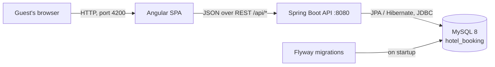
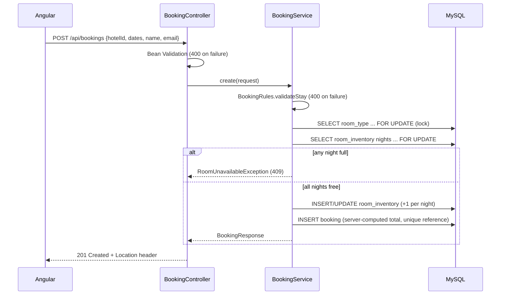
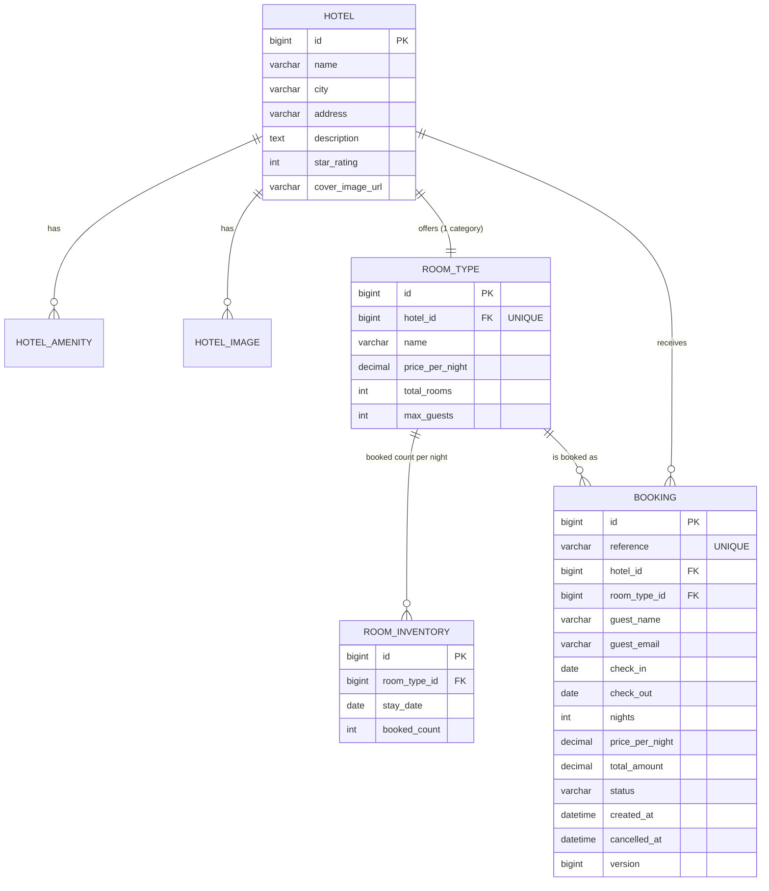
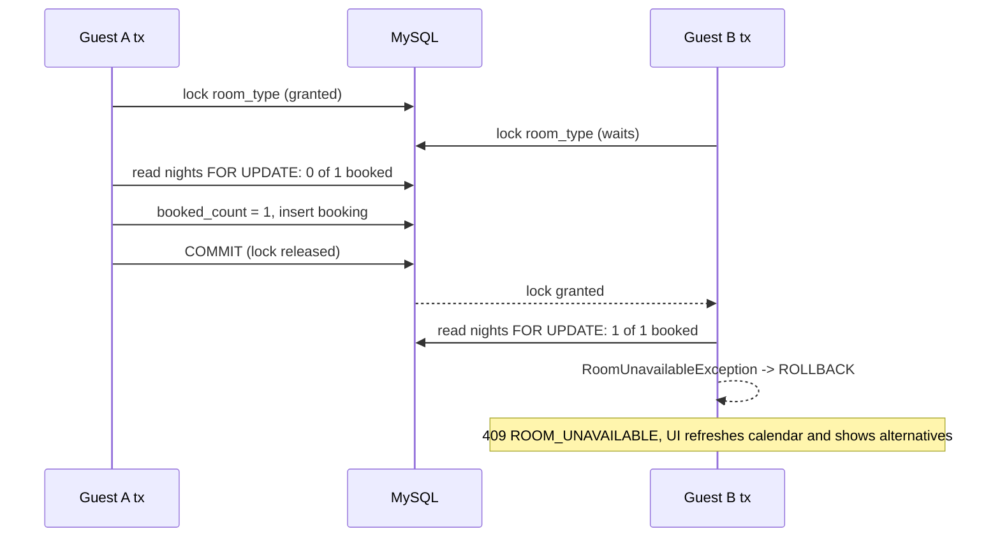

# Staybook – Design Write-up

This document explains how the hotel booking portal is built and why. It follows the eight
points requested in the brief.

1. [Architecture](#1-architecture)
2. [Database design](#2-database-design)
3. [API design](#3-api-design)
4. [Booking logic](#4-booking-logic)
5. [Design decisions](#5-design-decisions)
6. [Simultaneous bookings](#6-simultaneous-bookings)
7. [Surprise feature](#7-surprise-feature-availability-calendar--nearest-available-dates)
8. [Limitations and improvements](#8-limitations-and-improvements)

Assumptions are listed separately in [ASSUMPTIONS.md](ASSUMPTIONS.md).

---

## 1. Architecture

Three tiers that talk only through well-defined interfaces:



**Frontend (Angular).** A single-page app built from standalone components and signals.
It owns presentation and instant feedback only: it mirrors the date rules so guests see problems
straight away, but it never decides anything that matters (price, availability). All calls go
through one `ApiService`. In development the Angular dev server proxies `/api` to the backend, so
the browser sees one origin and no CORS configuration is needed.

**Backend (Spring Boot).** A layered REST API:

```
controller  ->  service  ->  repository  ->  MySQL
   (HTTP)       (rules,        (Spring Data
   DTOs,        transactions,   JPA queries,
   validation)  locking)        row locks)
```

| Layer | Responsibility | Examples |
|-------|----------------|----------|
| `controller` | HTTP mapping, request validation (`@Valid`), status codes | `HotelController`, `BookingController` |
| `dto` | Request/response shapes as Java records; entities never leave the service layer | `CreateBookingRequest`, `BookingResponse`, `ApiError` |
| `service` | Business rules and transactions | `BookingRules` (pure), `AvailabilityService`, `BookingService`, `HotelService` |
| `repository` | Data access, including locking queries | `RoomTypeRepository.findByHotelIdForUpdate` |
| `entity` | JPA mappings of the tables | `Hotel`, `RoomType`, `RoomInventory`, `Booking` |
| `exception` | Typed business errors and one global handler | `RoomUnavailableException`, `GlobalExceptionHandler` |
| `config` | Typed settings, `Clock`, CORS | `AppProperties`, `AppConfig` |

**Database (MySQL).** Schema and seed data are versioned Flyway migrations
(`backend/src/main/resources/db/migration`). Hibernate does not generate the schema
(`ddl-auto: none`); the SQL files are the single source of truth.

**A request end to end (booking):**



---

## 2. Database design

### Entities and relationships



| Table | Purpose |
|-------|---------|
| `hotel` | The property: name, city, address, description, rating, cover image. |
| `hotel_amenity` | One row per amenity (composite PK `hotel_id, amenity` prevents duplicates). |
| `hotel_image` | Ordered gallery (PK `hotel_id, sort_order`). |
| `room_type` | The bookable category: price per night and **total rooms** (capacity). |
| `room_inventory` | **How many rooms are taken on each night** for a room type. |
| `booking` | One reservation of one room for a date range. |

### Important constraints

| Constraint | Why |
|-----------|-----|
| `uk_room_type_hotel UNIQUE (hotel_id)` | Enforces "one room category per hotel" from the brief. Removing this one key is enough to allow several categories; nothing else assumes one. |
| `uk_inventory_room_date UNIQUE (room_type_id, stay_date)` | Exactly one counter per room type per night. |
| `chk_inventory_non_negative CHECK (booked_count >= 0)` | A release can never push a count below zero. |
| `uk_booking_reference UNIQUE (reference)` | References are unique, enforced by the database, not only by the code. |
| `chk_booking_dates CHECK (check_out > check_in)` | No zero-length or reversed stays can be stored, even by a buggy client. |
| `chk_booking_status CHECK (status IN ('CONFIRMED','CANCELLED'))` | Only known states. |
| `chk_room_price_positive`, `chk_room_total_positive`, `chk_booking_amount` | No free or negative prices, no hotels with zero rooms. |
| Foreign keys on every reference | No orphan bookings or inventory rows. |
| `idx_booking_email`, `idx_booking_room_dates`, `idx_hotel_city` | Support lookups by email, by room/date, and search by city. |

`booked_count <= total_rooms` cannot be a MySQL `CHECK` because it compares two tables. It is
enforced in `AvailabilityService.reserve` while the room type row is locked (see section 6).

### Why a per-night inventory table?

The alternative is to compute availability on the fly by counting overlapping bookings. Both work;
I chose an explicit `room_inventory` table because:

- **The brief asks to persist room availability.** The table *is* the availability.
- **Checks are simple and exact.** "Is a room free for this stay?" becomes "is
  `booked_count < total_rooms` on every night?" With overlapping-booking counts, the busiest
  night inside the range is what matters, which needs a per-day sweep anyway.
- **It gives a natural row to lock** per night and is fast to read for the calendar feature
  (one indexed range scan returns a month).
- **It scales to future features**: closing a date for maintenance, per-night prices, or
  overbooking allowances are just extra columns on the same row.

The trade-off is that two places must agree (bookings and counters). Both are only changed together
inside one transaction, and tests check that a cancellation releases exactly what a booking took.

Rows are created lazily, only for nights that have been booked at least once. A missing row means
zero rooms taken, so there is no need to pre-generate a year of empty rows per hotel.

### Money and time types

- Prices are `DECIMAL(10,2)` / `BigDecimal`, never floating point.
- Stay dates are `DATE` / `LocalDate`: a hotel night is a calendar date, not an instant.
- Audit timestamps (`created_at`, `cancelled_at`) are `DATETIME(6)` stored in UTC.

---

## 3. API design

Base path `/api`. JSON in and out. Dates are ISO `YYYY-MM-DD`.
Full examples: [docs/API.md](docs/API.md).

| Method | Path | Purpose | Success |
|--------|------|---------|---------|
| GET | `/hotels?location=&checkIn=&checkOut=` | Browse or search hotels. With dates, each result includes `availableRooms` for that stay. | 200 |
| GET | `/hotels/locations` | Distinct cities for the search suggestions. | 200 |
| GET | `/hotels/{id}?checkIn=&checkOut=` | Hotel details, gallery, amenities, room; with dates also availability and total. | 200 |
| GET | `/hotels/{id}/calendar?from=&days=` | *Surprise feature.* Rooms left per night (1–62 days). | 200 |
| GET | `/hotels/{id}/alternatives?checkIn=&checkOut=` | *Surprise feature.* Nearest same-length stays with a free room. | 200 |
| POST | `/bookings/quote` | Server-side price and availability for a stay, shown before confirming. Changes nothing. | 200 |
| POST | `/bookings` | Create a booking. Returns the booking with its reference. | 201 + `Location` |
| GET | `/bookings/{reference}?email=` | Retrieve a booking. Email must match. | 200 |
| POST | `/bookings/{reference}/cancel` | Cancel a booking. Body `{ "email": "..." }`. | 200 |

**Design choices**

- **Resources are nouns, actions are explicit.** Cancelling is `POST /bookings/{ref}/cancel`,
  not `DELETE`, because the booking is not deleted. It moves to `CANCELLED` and stays as a record.
- **The client never sends a price.** `CreateBookingRequest` has no amount field, so a tampered
  request cannot change what is charged.
- **Quote is separate from create.** The guest sees the exact backend-computed total before
  confirming, and the create call recomputes it anyway.
- **Same answer for wrong reference and wrong email** (`404 BOOKING_NOT_FOUND`), so references
  cannot be probed to find out which exist.

### Error format

Every error, from any layer, has the same shape:

```json
{
  "timestamp": "2026-11-24T06:12:03.511Z",
  "status": 409,
  "error": "Conflict",
  "code": "ROOM_UNAVAILABLE",
  "message": "Sorry, no rooms are left for the night of 2026-12-01. Please try different dates.",
  "path": "/api/bookings",
  "fieldErrors": []
}
```

`message` is written for guests and shown as-is by the UI. `code` is stable and meant for code
(the frontend uses `ROOM_UNAVAILABLE` to refresh the calendar). `fieldErrors` lists per-field
problems so the form can show them under the right input.

| Code | HTTP | When |
|------|------|------|
| `VALIDATION_FAILED` | 400 | Bean Validation failed (blank name, bad email, ...). `fieldErrors` filled. |
| `MALFORMED_REQUEST` | 400 | Unreadable JSON or a date not in `YYYY-MM-DD`. |
| `INVALID_PARAMETER`, `MISSING_PARAMETER` | 400 | Bad or missing query parameter. |
| `DATES_REQUIRED`, `DATES_INCOMPLETE` | 400 | One or both dates missing. |
| `CHECK_IN_IN_PAST` | 400 | Check-in before today. |
| `CHECK_OUT_NOT_AFTER_CHECK_IN` | 400 | Check-out on or before check-in. |
| `STAY_TOO_LONG` | 400 | More than 30 nights. |
| `CHECK_IN_TOO_FAR` | 400 | Check-in more than 365 days ahead. |
| `HOTEL_NOT_FOUND`, `ROOM_NOT_FOUND` | 404 | Unknown hotel. |
| `BOOKING_NOT_FOUND` | 404 | Reference and email do not match a booking. |
| `ROOM_UNAVAILABLE` | 409 | At least one night of the stay is full. Message names the night. |
| `BOOKING_ALREADY_CANCELLED` | 409 | Cancelling twice. |
| `BOOKING_NOT_CANCELLABLE` | 409 | Check-in date has passed. |
| `BOOKING_CHANGED` | 409 | Two requests changed the same booking at once (optimistic lock). |
| `BUSY` | 503 | Could not get a row lock in time under heavy load. |
| `INTERNAL_ERROR` | 500 | Anything unexpected. Details are logged, never sent to the client. |

---

## 4. Booking logic

### Stay model

A stay is the half-open interval **[check-in, check-out)**. The guest occupies the *nights* that
start on check-in up to, but not including, check-out. A stay from 10 Dec to 13 Dec uses the
nights of 10, 11 and 12 Dec: **3 nights**.

This is how hotels work and it makes overlap rules fall out naturally:

| Booking A | Booking B | Overlap? | Why |
|-----------|-----------|----------|-----|
| 10 → 13 | 13 → 15 | **No** | A checks out the morning B checks in. Nights 10,11,12 vs 13,14. |
| 10 → 13 | 12 → 14 | **Yes, on night 12** | Both need a room on the night of the 12th. |
| 10 → 13 | 11 → 12 | **Yes, on night 11** | B is inside A. |

A room type with *N* rooms can hold up to *N* overlapping bookings on any night. A new stay is
accepted only if **every** night in its range has `booked_count < total_rooms`.

### Pricing

```
nights = days between check-in and check-out
total  = price_per_night x nights      (BigDecimal, rounded to 2 decimals, HALF_UP)
```

- Calculated only on the backend (`BookingRules.totalFor`), both for the quote and again when
  creating the booking.
- The price per night and the total are **copied into the booking**, so changing a hotel's price
  later never changes existing bookings.
- Prices are taken to include taxes; there are no fees or discounts (see ASSUMPTIONS.md).

### Date validation (`BookingRules.validateStay`)

Checked in this order, each with its own error code:

1. Both dates present.
2. Check-in is not before **today** (today is computed in the hotels' time zone,
   `Asia/Kolkata` by default, through an injected `Clock`).
3. Check-out is strictly after check-in (at least one night).
4. Check-in is at most 365 days ahead.
5. Stay is at most 30 nights.

The same rules run in the browser for instant feedback, but the backend is the authority. A
request that skips the UI gets exactly the same checks.

### Availability check and reservation (`AvailabilityService.reserve`)

Inside one transaction, after taking the room type lock:

1. Read the inventory rows for every night of the stay with `SELECT ... FOR UPDATE`.
2. For each night, if `booked_count >= total_rooms`, throw `RoomUnavailableException` naming that
   night. **Nothing has been changed yet**, so a failure leaves no partial reservation.
3. Only when every night has space: create missing rows, add 1 to each, save.
4. Create the booking with a unique reference.

If anything fails, the transaction rolls back and no night is taken (covered by
`failedBookingDoesNotTakeAnyNight`).

### Booking references

`SB-` followed by 8 characters from an alphabet without look-alikes (no `0/O`, `1/I/L`), generated
with `SecureRandom`. That is 31⁸ ≈ 8.5 × 10¹¹ combinations: hard to guess and easy to read out on
the phone. The service retries on the rare clash and the database unique key is the final guard.

### Retrieval and cancellation

- Retrieval needs **reference and email**. Reference is case-insensitive; email is compared
  case-insensitively and trimmed. Emails are stored lower-cased.
- Cancellation:
  1. Find the booking (same reference + email check).
  2. Reject if already cancelled (`409 BOOKING_ALREADY_CANCELLED`).
  3. Reject if check-in is before today, i.e. the stay has started (`409 BOOKING_NOT_CANCELLABLE`).
  4. Lock the room type row, read the nights `FOR UPDATE`, subtract 1 from each (never below 0).
  5. Mark the booking `CANCELLED` with `cancelled_at`. The row is kept for history.
- The released nights are immediately bookable again (`cancellingReleasesTheNights` test).

---

## 5. Design decisions

| Decision | Alternatives considered | Why this one / trade-off |
|----------|------------------------|--------------------------|
| **Per-night `room_inventory` table** | Count overlapping bookings at query time | Explicit availability as the brief asks, simple "every night has space" check, a natural row to lock, fast calendar reads. Cost: counters must stay in sync with bookings, which is done in one transaction and tested. |
| **Pessimistic lock on the room type row** | Optimistic locking with `@Version` on inventory rows and retry; `UPDATE ... SET booked_count = booked_count + 1 WHERE booked_count < total` per night | Simplest to reason about and correct under MySQL's default isolation. It serialises bookings *per hotel*, which is fine for this scale. Optimistic retry is better under very high contention on different nights; noted as an improvement. |
| **Flyway migrations** | `ddl-auto=update`, hand-run SQL | Repeatable, versioned, reviewable schema. Same scripts for every developer. |
| **Java records as DTOs** | Expose entities directly | Entities never leak (no lazy-loading surprises, no accidental fields like `version`), and API shape can change independently of tables. |
| **`BookingRules` as a pure class** | Rules inside the service | Unit-testable without Spring or a database; one place for every rule. |
| **Injected `Clock`** | `LocalDate.now()` everywhere | Tests can freeze "today"; the hotel's time zone, not the server's, decides what today is. |
| **Email + reference instead of accounts** | Login | Authentication is out of scope. Two factors (something you were given + something you know) is a reasonable bar for a demo; rate limiting is listed as an improvement. |
| **Cancel = status change** | Delete the row | Keeps history, makes double-cancel detectable, and lets `version` catch concurrent cancels. |
| **Angular standalone components + signals** | NgModules, NgRx | Less boilerplate; state per page is small, so a store would be overkill. |
| **Dev-server proxy for `/api`** | Hard-coded backend URL + CORS | One origin in the browser, no CORS errors. CORS is still configured for other setups. |
| **Query params hold search state** | In-memory service | Searches and hotel pages with dates can be refreshed, bookmarked and shared. |
| **Solid colours, square corners, CSS animations** | Component library | Matches the requested style, small bundle (~90 kB initial gzip), no dependency on a UI kit. |

---

## 6. Simultaneous bookings

**Scenario:** one room left; two guests press "Confirm" at the same moment.

### How it is handled

Every operation that changes availability for a room type first runs:

```sql
SELECT ... FROM room_type WHERE hotel_id = ? FOR UPDATE;   -- findByHotelIdForUpdate
```

InnoDB grants this row lock to one transaction at a time. The flow:



Two details make this correct rather than just likely:

1. **Locking reads for the counters.** Under MySQL's default `REPEATABLE READ`, a plain `SELECT`
   inside a transaction can return an older snapshot. The inventory rows are therefore also read
   with `FOR UPDATE` (`findRangeForUpdate`), which always returns the latest committed values. So
   guest B is guaranteed to see guest A's `booked_count = 1`.
2. **Check everything before changing anything.** The capacity of every night is checked first,
   then counts are incremented. A failed check leaves nothing to undo.

The same lock is taken by cancellation, so a cancel and a booking for the same hotel cannot
interleave and lose an update.

**Double cancellation** of the same booking by two requests is caught by the `@Version` column on
`booking`: the second commit fails with an optimistic-lock error, its inventory release is rolled
back, and the client gets `409 BOOKING_CHANGED`.

**Lock waits** are bounded by `innodb_lock_wait_timeout` (50 s default). If it ever expires the
client gets `503 BUSY` with a "try again" message rather than a 500.

### Proof

`BookingServiceIntegrationTest.onlyOneOfManySimultaneousRequestsGetsTheLastRoom` starts **8 threads**
held behind a latch, releases them together against a hotel with **1 room**, and asserts exactly
1 booking succeeds, 7 get `RoomUnavailableException`, and availability ends at 0.

### Other ways it could be done

| Approach | How | Trade-off |
|----------|-----|-----------|
| Conditional update | `UPDATE room_inventory SET booked_count = booked_count + 1 WHERE room_type_id=? AND stay_date=? AND booked_count < ?` for each night; if any affects 0 rows, roll back | No explicit lock wait on the parent row; more concurrency across different nights. Needs rows to exist first (`INSERT IGNORE` / upsert) and careful rollback. A good next step at higher volume. |
| Optimistic locking | `@Version` on inventory rows, retry on conflict | Great when conflicts are rare; needs a retry loop and can starve under heavy contention. |
| `SERIALIZABLE` isolation | Let the database serialise everything | Simple but heavy; more deadlocks and lower throughput. |
| Short "hold" before payment | Reserve for N minutes, then confirm | Needed once payment exists, so guests are not charged for a room someone else got. |
| Queue per hotel | Push booking commands onto a per-hotel queue | Scales and is fair, but adds infrastructure; overkill here. |

---

## 7. Surprise feature: Availability calendar + nearest available dates

### What it does

On every hotel page:

- A **swipeable date strip** shows the next 30 days (load more up to 90). Each day shows how many
  rooms are left and is coloured: white = available, gold = few left, rose with strike-through =
  sold out. The guest's selected nights are shown in dark ink.
- **Tap to choose dates**: first tap sets check-in, second tap sets check-out. The booking panel
  updates the total at once.
- If the chosen stay is **sold out**, the panel lists up to four **nearest same-length stays that
  still have a room on every night**, e.g. *"Thu 26 Nov to Sat 28 Nov · 2 days earlier · ₹10,400"*.
  One tap applies them.
- If a booking fails because someone else just took the last room, the calendar and suggestions
  refresh automatically.

### Why I chose it

The most frustrating moment in hotel booking is "Sold out" with no next step. Guests then guess
dates one by one. Most travellers are a little flexible, so the useful answer to "sold out" is
"here is the closest thing that works". The calendar also helps before that point: guests can see
busy weekends at a glance instead of discovering them by trial and error. It uses data the system
already has (the inventory table), so it adds real value at small cost, and it showcases the
availability model.

### How it is implemented

**Backend**

- `GET /api/hotels/{id}/calendar?from=&days=` → `HotelService.calendar` calls
  `AvailabilityService.availableByNight`, which reads the inventory rows for the range in a single
  indexed query and fills in missing nights as fully available. Each day gets a level:
  `SOLD_OUT` (0 left), `LIMITED` (≤ 30% of rooms, at least 1), or `AVAILABLE`.
- `GET /api/hotels/{id}/alternatives?checkIn=&checkOut=` → validates the stay with the normal rules,
  loads availability for 14 days either side in one query, then calls
  **`AlternativeDateFinder.find`**, a pure function:
  - tries shifts in the order **+1, −1, +2, −2, …, ±14** days, so plans move as little as possible,
    preferring later before earlier at equal distance;
  - skips windows that start before today or beyond the booking window;
  - keeps a window only if *every* night has at least one room, and reports the fewest rooms left
    across it;
  - stops after 4 suggestions.
  Prices for suggestions use the same `BookingRules.totalFor`.
- Unit tests in `AlternativeDateFinderTest`, plus an integration test around a sold-out night.

**Frontend**

- `HotelDetailComponent` loads the calendar after the hotel, renders it as a horizontal
  scroll-snap strip with arrow buttons, and handles two-tap range selection.
- When a quote comes back with `available: false`, it fetches alternatives and shows them as
  buttons; choosing one sets the dates and re-quotes.
- On `409 ROOM_UNAVAILABLE` from create, it reloads both the calendar and the quote.

Seed migration `V3__demo_bookings.sql` makes Misty Hills (2 rooms) sold out on
today+5 … today+7 and Lakeview Palace "few left" on today+10 … today+12, so the feature can be seen
immediately.

---

## 8. Limitations and improvements

**Current limitations**

- **No authentication.** Reference + email protects a booking; there is no rate limiting, so
  references could in theory be brute-forced slowly. The lookup also sends the email in a query
  string (`GET ?email=`), which can end up in server logs.
- **No payment or holds.** A booking is confirmed immediately; with payments a time-limited hold
  would be needed.
- **One room per booking, one room category per hotel**, a single flat price per night, no taxes,
  fees, discounts or guest-count pricing.
- **No emails sent.** The confirmation exists only on screen (and is retrievable later).
- **Per-hotel lock** serialises all bookings for one hotel. Fine for this scale; would limit very
  busy properties.
- **"Today" uses one configured time zone** for all hotels.
- **Images are hot-linked** from Unsplash; offline, the UI shows solid-colour placeholders.
- **No idempotency key** on create: double-submitting from two tabs makes two bookings (the UI
  disables the button while submitting).
- **Frontend tests** are not included; testing effort went into the backend rules as requested.

**With more time I would**

1. Add accounts (or magic-link email) and rate limiting on lookup/cancel; move lookup to `POST`.
2. Send confirmation and cancellation emails (Spring Mail + a template) and an `.ics` calendar file.
3. Switch reservation to conditional per-night `UPDATE`s for higher concurrency, and add an
   `Idempotency-Key` header on `POST /bookings`.
4. Support several room types per hotel, per-night pricing (weekends, seasons) and taxes.
5. Add a cancellation policy (e.g. free until 48 h before check-in) and partial refunds.
6. Pagination and filters (price range, amenities, rating) on search; map view.
7. Testcontainers with real MySQL for integration tests; Playwright end-to-end tests for the UI;
   CI pipeline running both.
8. Docker Compose for one-command startup, OpenAPI/Swagger docs, and structured logging/metrics.
9. Store hotel images in object storage with resized variants.
